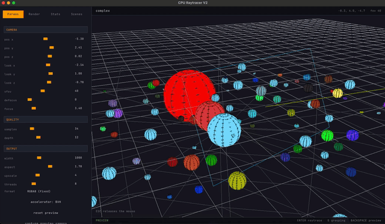
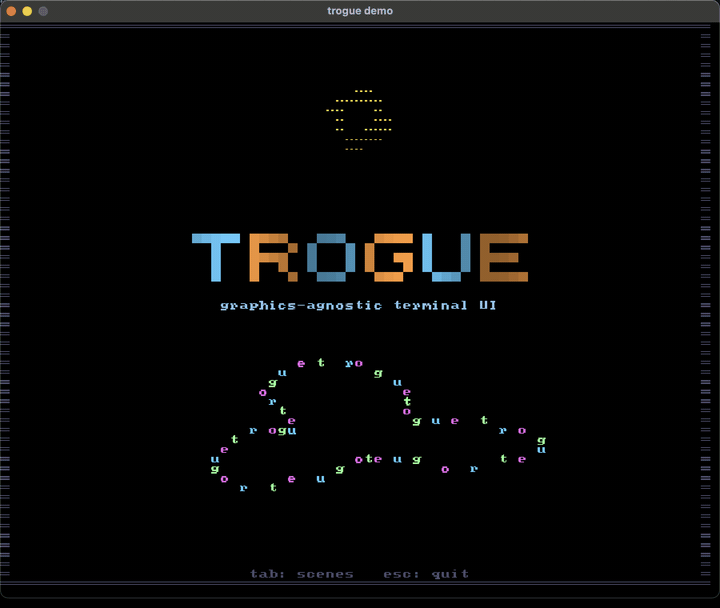
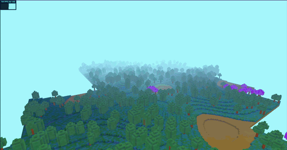

# Hey! 👋 I'm Lucas Gobbi

I'm a software engineer at [Tractian](https://tractian.com/), working on systems integration, backend development, and software architecture.

My interests go beyond day-to-day software engineering. I enjoy exploring how things work under the hood, building software from scratch, and experimenting with different programming languages, algorithms, and graphics technologies.

## 🔬 Interests

- **Computer Graphics & Rendering** — ray tracing, shaders, GPU programming, and real-time rendering.
- **Systems Programming** — low-level development, memory management, concurrency, and performance optimization.
- **Programming Languages & Tools** — experimenting with languages like Odin, Rust, C, and C++, building libraries, DSLs, and developer tools.
- **Backend & Distributed Systems** — APIs, integrations, messaging, workflow orchestration, and reliable software architecture.
- **Mathematics & Algorithms** — exploring the mathematical foundations behind graphics, simulations, and computational problems.

## 🛠️ Technologies

**Languages:** TypeScript, JavaScript, Python, Go, Rust, Odin, C, C++, and ABAP.

**Backend & Infrastructure:** Node.js, Kafka, Temporal, Docker, MongoDB, and PostgreSQL.

**Graphics & UI:** Vulkan, OpenGL, raylib, Dear ImGui, and shader programming.

I'm always exploring new tools and languages, so this list reflects my interests and experience rather than an exhaustive list of everything I use.

## 🧪 What I'm Building

I enjoy learning by building things, especially projects that combine theory with practical implementation.

Some of the things I work on in my spare time:

- A CPU ray tracer in Odin ([toy_raytracer_odin](https://github.com/LucasGobbs/toy_raytracer_odin)) with BVH acceleration, PBR materials, and an interactive editor UI.

- trogue, a graphics-agnostic terminal-look UI API in Rust ([trogue](https://github.com/LucasGobbs/trogue)): buffers of glyphs, shapes and components, rendered by pluggable backends.

- A voxel engine prototype in three.js ([cube-engine](https://github.com/LucasGobbs/cube-engine)): chunked simplex-noise terrain, face-culled meshes, baked ambient occlusion, and a fly camera.

I particularly enjoy projects where I can explore the entire stack, from algorithms and data structures to memory management, rendering, and user interfaces.

## 📫 Get in Touch

Feel free to explore my repositories, open an issue, or reach out through GitHub discussions.
